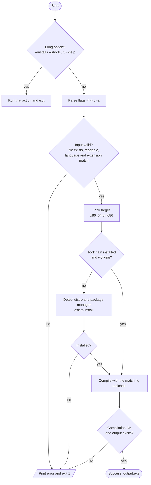

<div align="center">


<br><br>

# 1FileCompiler

**Cross-compile C, C++ and Rust source files into Windows `.exe` binaries — straight from your Linux terminal, with one command.**

<br>


</div>

---

## Table of Contents

- [Features](#features)
- [Supported Languages](#supported-languages)
- [Requirements](#requirements)
- [Installation](#installation)
- [Usage](#usage)
- [Options](#options)
- [Examples](#examples)
- [How It Works](#how-it-works)
- [Error Handling](#error-handling)
- [Supported Distributions](#supported-distributions)
- [Testing the Output](#testing-the-output)
- [Troubleshooting](#troubleshooting)
- [Contributing](#contributing)
- [License](#license)

---

## Features

- **One command, one `.exe`** — no Makefiles, no IDE, no Windows machine needed.
- **Auto language detection** — infers `c`, `cpp` or `rust` from the file extension.
- **Smart dependency check** — verifies that the toolchain exists *and actually runs* before compiling.
- **Auto-installer** — detects your distro and package manager, then installs `mingw-w64` (and Rust if needed).
- **Static binaries** — the produced `.exe` runs on Windows without extra DLLs.
- **32-bit and 64-bit targets** — pick with a single flag.
- **Global shortcut** — run it from anywhere as `1Filecompiler`.
- **Clear error messages** — every invalid input prints a readable `[ERROR]` message and exits with a non-zero code.

## Supported Languages

| Language | Extensions | Toolchain used |
| :------: | :--------- | :------------- |
|  | `.c` | `x86_64-w64-mingw32-gcc` |
|  | `.cpp` `.cc` `.cxx` | `x86_64-w64-mingw32-g++` |
|  | `.rs` | `rustc` + `x86_64-pc-windows-gnu` target |

## Requirements

| Requirement | Needed for | Installed by `--install`? |
| :---------- | :--------- | :-----------------------: |
| Linux with **Bash 4+** | Running the script | — |
| `mingw-w64` | C / C++ / Rust linking | Yes |
| Rust (`rustc` + `rustup`) | Rust files only | Yes |
| `curl` | Installing Rust | No |
| `sudo` (or root) | Installing packages | — |

> You only need the tools for the language you actually compile. A C++ project does not need Rust, and vice versa.

## Installation

```bash
# 1. Clone the repository
git clone https://github.com/DeadSec0Chair/Bash_Compiler.git
cd Bash_Compiler

# 2. Make the script executable
chmod +x 1FileCompiler.sh

# 3. Install the required tools (auto-detects your distro)
./1FileCompiler.sh --install

# 4. (Optional) Create a global command
./1FileCompiler.sh --shortcut
```

After step 4 you can run the tool from any directory:

```bash
1Filecompiler --help
```

The shortcut is a symlink created in `/usr/local/bin` (or `~/.local/bin` when `sudo` is not available). If you move the script, run `--shortcut` again from its new location. To remove it:

```bash
./1FileCompiler.sh --remove-shortcut
```

## Usage

```bash
1FileCompiler.sh -f <source_file> -l <language> -o <output.exe> [-a <arch>]
```

## Options

| Option | Description | Default |
| :----- | :---------- | :------ |
| `-f` | Source file (`.c`, `.cpp`, `.rs`) | *required* |
| `-l` | Language: `c`, `cpp` or `rust` | auto-detected from extension |
| `-o` | Output file name (`.exe` is appended if missing) | `<source name>.exe` |
| `-a` | Target architecture: `64` or `32` | `64` |
| `--install` | Detect distro and install `mingw-w64` (and Rust if missing) | — |
| `--shortcut` | Create the global `1Filecompiler` command | — |
| `--remove-shortcut` | Remove the global command | — |
| `-h`, `--help` | Show the help screen | — |

## Examples

```bash
# C++ -> 64-bit Windows executable
1FileCompiler.sh -f main.cpp -l cpp -o app.exe

# C -> 64-bit Windows executable
1FileCompiler.sh -f main.c -l c -o app.exe

# Rust -> 32-bit Windows executable
1FileCompiler.sh -f main.rs -l rust -o app.exe -a 32

# Language auto-detected, output name auto-generated (-> main.exe)
1FileCompiler.sh -f main.cpp
```

## How It Works



**Step by step:**

1. **Long options first.** `--install`, `--shortcut`, `--remove-shortcut` and `--help` are handled before anything else, so they work without any other arguments.
2. **Argument parsing.** The remaining flags (`-f -l -o -a`) are read with `getopts`.
3. **Input validation.** The script checks that the file exists and is readable, detects the language from the extension when `-l` is omitted, and verifies that the language matches the extension and the architecture is `32` or `64`.
4. **Dependency check.** Each required tool must exist *and* respond to `--version`. If something is missing, the script reports it, shows your distro and package manager, and offers to install it.
5. **Compilation.** The correct cross-compiler is invoked:

   | Language | Command (64-bit example) |
   | :------- | :----------------------- |
   | C | `x86_64-w64-mingw32-gcc file.c -o out.exe -O2 -static` |
   | C++ | `x86_64-w64-mingw32-g++ file.cpp -o out.exe -O2 -static -static-libgcc -static-libstdc++` |
   | Rust | `rustc file.rs --target x86_64-pc-windows-gnu -C opt-level=2 -C linker=x86_64-w64-mingw32-gcc -o out.exe` |

   For Rust, the Windows target is added automatically with `rustup target add` if it is not installed yet.
6. **Final verification.** The script confirms the compiler exited cleanly and that the output file really exists before reporting success.

## Error Handling

All errors are printed to `stderr` with an `[ERROR]` prefix and the script exits with code `1`.

| Situation | Message |
| :-------- | :------ |
| Missing `-f` | `Missing source file (-f).` |
| File not found / not readable | `File '...' does not exist.` / `is not readable.` |
| Unknown language | `Invalid language '...'. Allowed values: c, cpp, rust.` |
| Wrong extension for the language | `Language is 'rust' but file extension is '.cpp' (expected .rs).` |
| Invalid architecture | `Invalid architecture '...'. Allowed values: 64, 32.` |
| Output folder missing | `Output directory '...' does not exist.` |
| Toolchain missing | `Missing or not working: ...` + install prompt |
| Compile error | `Compilation failed (exit code N).` |

## Supported Distributions

`--install` detects your package manager automatically:

| Package manager | Distributions |
| :-------------- | :------------ |
| `apt` | Ubuntu, Debian, Linux Mint, Kali |
| `dnf` / `yum` | Fedora, RHEL, CentOS |
| `pacman` | Arch, Manjaro |
| `zypper` | openSUSE |
| `apk` | Alpine |
| `xbps` | Void Linux |

On any other system, install `mingw-w64` manually and run the script as usual.

## Testing the Output

You can try the generated executable on Linux with [Wine](https://www.winehq.org/):

```bash
wine app.exe
```

## Troubleshooting

**`command not found: 1Filecompiler`**
`~/.local/bin` is probably not in your `PATH`. Add this line to `~/.bashrc` and restart the terminal:

```bash
export PATH="$HOME/.local/bin:$PATH"
```

**The shortcut stopped working after I moved the script.**
The shortcut points to the original file location. Run `./1FileCompiler.sh --shortcut` again from the new folder.

**Rust build fails at the linking step.**
Make sure `mingw-w64` is installed (`./1FileCompiler.sh --install`) and that the matching Rust target exists: `rustup target list --installed`.

## Contributing

Contributions are welcome.

1. Fork the repository
2. Create a feature branch: `git checkout -b feature/my-feature`
3. Commit your changes: `git commit -m "Add my feature"`
4. Push the branch: `git push origin feature/my-feature`
5. Open a Pull Request

## License

Distributed under the MIT License. Add a `LICENSE` file to the repository root to make it official.

---

<div align="center">

Made with Bash.  If this tool saved you time, consider leaving a star.

</div>
