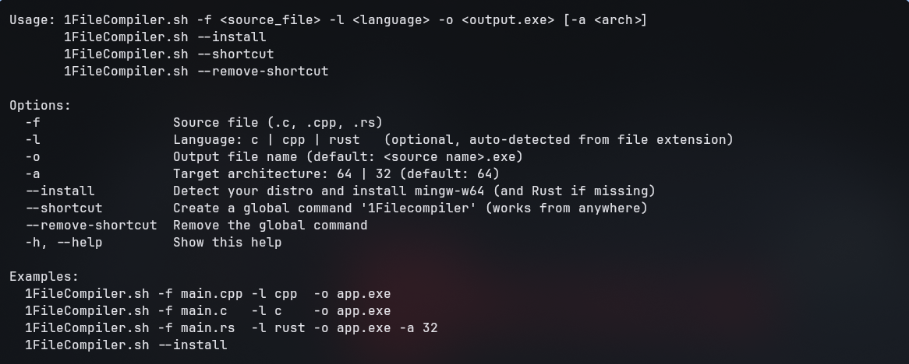

# 1FileCompiler

<div align="center">
  
</div>

A simple Bash tool to compile C, C++, and Rust source files into Windows `.exe` executables directly from Linux.

### Features

- Supports C, C++, and Rust.
- Generates Windows `.exe` executables.
- Supports 32-bit and 64-bit architectures.
- Automatically detects the programming language.
- Checks required compilers and dependencies.
- Offers automatic dependency installation.
- Creates a global terminal command.

### Requirements

- Linux
- Bash 4+
- Required cross-compilation toolchains.

### Installation

```bash
git clone https://github.com/DeadSec0Chair/1FileCompiler.git
cd 1FileCompiler

chmod +x CompilerExe.sh
./CompilerExe.sh --install
```

### Usage

```bash
./CompilerExe.sh -f main.cpp
```

### Examples

```bash
# Compile C
./CompilerExe.sh -f main.c -l c

# Compile C++
./CompilerExe.sh -f main.cpp -l cpp

# Compile Rust
./CompilerExe.sh -f main.rs -l rust

# Build for 32-bit Windows
./CompilerExe.sh -f main.cpp -a 32

# Set output filename
./CompilerExe.sh -f main.cpp -o app.exe
```

### Additional Commands

```bash
# Show help
./CompilerExe.sh --help

# Create global command
./CompilerExe.sh --shortcut

```

### Supported Package Managers

APT, DNF, YUM, Pacman, Zypper, APK, and XBPS.

### License

MIT License
